# PolyQuant Terminal — Design for Review

Version: 0.1 · Date: October 16, 2026 · Status: Design approved; product implementation has not started.

**Review update:** The owner approved this design on October 16. The [detailed implementation plan](docs/superpowers/plans/2026-10-16-polyquant-terminal.md) and [public production verification](docs/PRODUCTION_API_AVAILABILITY.md) are now available. Both requested BTC cadences were observed through production APIs; reference reconstruction failed and authenticated streaming remains untested. Product implementation has not started. The approved requirements below are preserved.

## Intended outcome

Build a local, English-language Polymarket US research terminal that records real BTC 15-minute and 1-hour market data, automatically trades simulated capital, and measures whether an executable advantage survives fees and conservative execution. An engineering release can pass while the strategy result remains insufficient evidence or no demonstrated edge.

This package proposes behavior and acceptance criteria. It contains no running application, authenticated connection results, strategy performance results, or live-trading authorization.

## Confirmed requirements

| Decision | Agreed requirement |
|---|---|
| Venue | Polymarket US only; no international trading gateway |
| First release | Real market data; automatic paper orders; real orders prohibited in code |
| Strategies | Interpretable probability baseline first; momentum and book signals tested independently; combine only after evidence |
| Accounts | One main probability account and separate experimental accounts, each initially $1,000; results never added together |
| Risk per account | 0.5% maximum loss budget per trade, including costs; 5% combined exposure; 2% daily loss; two open positions; no leverage or loss recovery sizing |
| Execution | Marketable limit orders sweep arrival-time visible liquidity; partial fills allowed; remainder canceled |
| Exit | Hold to official settlement by default; early exits are separate experiments |
| Halts | Cancel unfilled simulated orders; retain actual simulated holdings; continue accounting and official settlement; persist halt reasons |
| Data | Record real books if historical books are unavailable; never substitute price history for execution evidence |
| Parameters | Versioned, frozen experiments; no automatic online retuning |
| Storage | 10GB raw-data budget; warn near limit; stop capture and new entries at limit; preserve recorded samples and account records |
| Deployment | Single user, localhost, local login, Docker Compose; later server migration |
| Language | English interface, documentation, logs, and project communication |
| GitHub | New private `jeffsasha/PolyQuant-Terminal`; feature branches and reviewable PRs; owner approves merge and production deployment |
| Credentials | Owner has a US API key; configure locally during integration; do not paste it into chat |

## Recommended architecture

Use a modular Python application, PostgreSQL, and a Next.js web application. Docker Compose starts three containers: `backend`, `db`, and `web`. One backend process owns the trading loop and ledger writes; replay runs separately with its own account namespace and data manifest. Redis, Kafka, microservices, and distributed workers are deferred until measurements justify them.

```mermaid
flowchart LR
    US[US discovery, books, index, settlement] --> Ingest[Read-only venue adapter and recorder]
    Spot[External BTC spot feed] --> Ingest
    Ingest --> Features[Validated market state and features]
    Features --> Signals[Frozen strategy version]
    Signals --> Risk[Central risk and capital reservation]
    Risk --> Paper[Paper execution at simulated arrival]
    Paper --> Ledger[PostgreSQL orders, fills, ledger, audit]
    Ingest --> Raw[Compressed raw recordings]
    Raw --> Replay[Replay with original availability times]
    Replay --> Features
    Ledger --> API[FastAPI and event stream]
    Features --> API
    API --> UI[English Next.js terminal]
```

All logical services requested in the original brief remain explicit modules. Process boundaries are deliberately fewer than module boundaries. See [Architecture](docs/ARCHITECTURE.md).

## Alternatives considered

| Approach | Benefit | Cost / limitation | Decision |
|---|---|---|---|
| Modular Python backend + PostgreSQL + Next.js | One transaction boundary and one shared strategy implementation; preserves requested terminal | Single trading writer; sufficient for two BTC cadences until measured otherwise | Recommended |
| Separate ingestion, strategy, execution, settlement services | Independent scaling and deployment | Distributed ordering and recovery complexity before throughput is known | Defer |
| Research notebook or simple Python dashboard | Fast statistical exploration | Does not satisfy the requested operational terminal and durable execution lifecycle | Use notebooks only for research if useful |

## Corrections to the original brief

1. **Production availability needs proof.** Official schema documentation describes automated families as preproduction, despite public US example pages. Check current production discovery, terms, and feeds before claiming that either cadence works. If absent, report `UNAVAILABLE`; no international or preproduction substitution. [Official schema](https://docs.polymarket.us/trader-guide/crypto-schema)
2. **Forecast the contract statistic.** The target is the specified settlement statistic, not the last external BTC tick. Validate each market's own rules and reference data before enabling reference-dependent strategies. See the source audit for documented averaging boundaries and discrepancies.
3. **Separate forecasting data from execution data.** Historical displayed prices do not establish historical book depth or attainable fills. A strategy may be researched before it can receive a credible execution backtest.
4. **Treat fee versions and rebates separately.** Apply effective fee rules and eligibility rather than a single timeless coefficient. Do not build profitability around assumed rebates. See [Research audit](docs/RESEARCH_AUDIT.md).
5. **Keep real order code unreachable.** Preserve an execution contract and disabled live stub, but exclude an operational live gateway from this release. An environment variable or UI change cannot enable it.
6. **Make the risk limits precise.** With two positions each capped at 0.5% maximum loss, the 5% portfolio ceiling is usually redundant. Keep it as an additional ceiling; never increase order sizes to use it.
7. **Account for arrival-time uncertainty.** Recorded top-of-book depth does not identify individual maker fills or queue positions. Report fee-rounding and fill uncertainty instead of inventing exchange precision.
8. **Make storage exhaustion compatible with settlement.** Keep raw-data quota separate from ledger headroom so a full recording budget does not prevent settlement or halt persistence.

## Trading behavior proposed for approval

The main account starts paused. After discovery, reference validation, warm-up, reconciliation, and an explicit Paper Start action, the probability baseline may submit simulated entries. Each decision records its data versions, probability, executable price, estimated costs, parameter version, and all risk results. Missing or uncertain inputs produce `NO TRADE` with a reason.

The first baseline estimates settlement probability from historical BRTI paths, with a zero-drift statistical benchmark. It models the end-window average and applies the market's rounding and tie rule. External spot price remains a separately labeled feature and never replaces the official threshold. Momentum and book models operate in isolated comparison accounts; no automatic selection of the recent winner.

Initial safety and experiment settings are explicit proposals in [Strategy research](docs/STRATEGY_RESEARCH.md). They are research defaults, not validated trading recommendations. The system may legitimately make zero trades.

## Terminal experience

The header shows `PAPER`, engine state, source health, observed latency, BTC spot, official index, and emergency stop. The main workspace contains a BTC chart, separate 15m/1h market panels, book and paper order ticket, then positions, executions, equity, and rejection history. Include dark/light themes, 1m/5m/15m/1h charts, relevant volume/VWAP only when supported, and signal explanations.

Use explicit states: `LIVE DATA`, `STALE`, `REPLAY`, `UNAVAILABLE`, `WARMING UP`, and `PAPER HALTED`. Fixture data belongs only in tests. A separate Smart Money page initially explains the verified data-access status; trader rankings and copying remain disabled without supporting US data.

## Implementation sequence and acceptance

Build in dependency order: source/API feasibility → persistent core → real data and recorder → execution/fees/risk → probability baseline and replay → comparisons and terminal → recovery/security/release verification. Each stage has an observable exit gate in [Implementation sequence](docs/IMPLEMENTATION_PLAN.md).

The [Acceptance matrix](docs/ACCEPTANCE.md) separates deterministic software checks, credentialed integration evidence, real-data observation, and statistical evaluation. No missing external dependency can be silently counted as passed. Profitability is not a software acceptance condition.

## Approval requested

Review the architecture, proposed research defaults, scope ordering, and acceptance gates together. Approval of this package authorizes preparation of the detailed implementation plan within this paper-only scope. Implementation and repository creation follow the approved plan. Merge, production deployment, and live activation remain separate owner decisions.

Open integration questions are engineering investigations rather than missing user preferences: production cadence availability, actual key/feed access, depth/update semantics, reference history coverage, settlement finality, and account-independent fee eligibility. A failed gate remains visible and prevents dependent trading.
